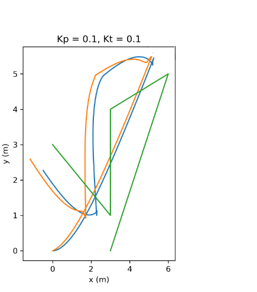

# Autonomous Mobile Robotics

A collection of robotics assignments built with **ROS 2**, **Gazebo**, and **Python**. The projects cover mobile robot kinematics, path-following controllers, and lidar-to-camera projection using the Hagen simulation environment.

## Projects

| Assignment | Description | Implementation |
| --- | --- | --- |
| **01 — Robot Motion** | Compare analytical and simulated trajectories for different velocity commands. | [Controller](homework1/hagen_control_strategy.py) · [Notebook](homework1/Visualization.ipynb) |
| **02 — Path Following** | Follow a piecewise-linear reference path with a proportional controller and analyze tracking performance. | [Controller](homework2/controlHW2.py) · [Report](homework2/README.md) |
| **03 — Control Strategies** | Implement and compare Pure Pursuit and Stanley controllers on the same reference path. | [Pure Pursuit](homework3/controlHW3PurePursuit.py) · [Stanley](homework3/controlHW3Stanley.py) · [Report](homework3/README.md) |
| **04 — Sensor Projection** | Combine Stanley control with projection of lidar measurements into the camera image. | [Controller](homework4/controlHW4.py) · [Demo](homework4/Video.mp4) |

## Path-following results

The plot below compares the reference path with the trajectories produced by the Pure Pursuit and Stanley controllers.



## Prerequisites

- A ROS 2 installation with `rclpy`, `rosdep`, and `colcon`
- Gazebo and the Hagen simulation packages
- Python 3 with NumPy, Matplotlib, OpenCV, and Jupyter

Install the Python packages used by the controllers and notebooks:

```bash
python3 -m pip install numpy matplotlib opencv-python jupyter
```

## Workspace setup

Create a ROS 2 workspace and clone both this repository and the simulation environment:

```bash
mkdir -p ~/ws/src
cd ~/ws/src
git clone https://github.com/GPrathap/autonomous_mobile_robots.git
git clone https://github.com/ipipos56/AutonomousMobileRoboticsHW.git
```

Install ROS dependencies and build the workspace:

```bash
cd ~/ws
rosdep install --from-paths src --ignore-src -r -y
colcon build
```

Before running the simulation, source ROS 2, Gazebo, and the workspace in each new terminal:

```bash
source /opt/ros/<distro>/setup.bash
source /usr/share/gazebo/setup.sh
source ~/ws/install/setup.bash
```

Replace `<distro>` with your installed ROS 2 distribution, for example `humble`.

## Running an assignment

Start the Gazebo simulation in one terminal:

```bash
ros2 launch hagen_gazebo hagen.launch.py
```

Then run a controller in another terminal:

```bash
cd ~/ws/src/AutonomousMobileRoboticsHW

# Assignment 1: motion and trajectory logging
python3 homework1/hagen_control_strategy.py

# Assignment 2: proportional path following
python3 homework2/controlHW2.py

# Assignment 3: Pure Pursuit or Stanley
python3 homework3/controlHW3PurePursuit.py
python3 homework3/controlHW3Stanley.py

# Assignment 4: lidar-to-camera projection
python3 homework4/controlHW4.py
```

Run only one controller at a time. Press `Ctrl+C` to stop it. To reset the simulation between runs:

```bash
ros2 service call /reset_simulation std_srvs/srv/Empty "{}"
```

The controllers log trajectory data to `info.json`, `info.txt`, or `sims.txt` in the directory from which they are launched. The notebooks use this data to generate trajectory plots.

## Repository layout

```text
homework1/   Motion experiments and trajectory visualization
homework2/   Proportional path-following controller and analysis
homework3/   Pure Pursuit and Stanley controllers with comparison plots
homework4/   Lidar-to-camera projection and video demonstration
```
